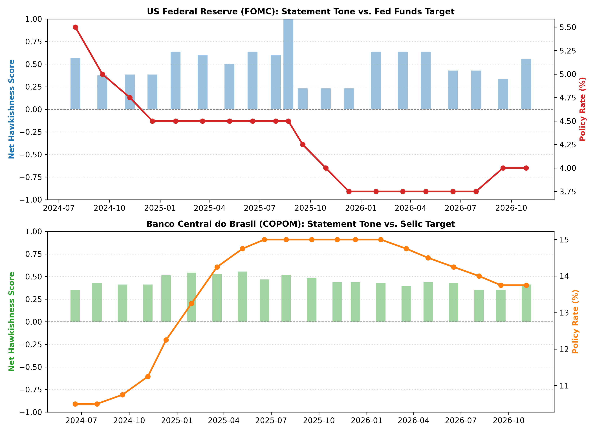

# US–Brazil Macroeconomic Models

A collection of empirical macroeconomics and data science projects comparing monetary policy, interest rates, and economic indicators between the United States and Brazil. Rather than relying on static classroom datasets, each module pulls primary data directly from the **Federal Reserve (FRED)** and **Banco Central do Brasil (BCB)** APIs.

---

## Repository Directory

| Project / Module | Focus | Tools & Data | Status |
| :--- | :--- | :--- | :--- |
| [`fedfunds_selic_regression.py`](./fedfunds_selic_regression.py) | Econometric OLS regression analyzing the relationship and rate transmission between the US Fed Funds rate and Brazil's Selic rate | Python, `statsmodels`, `pandas`, FRED API, BCB SGS API | Completed |
| [`central_bank_sentiment/`](./central_bank_sentiment/) | Bilingual NLP pipeline scoring hawkish/dovish policy tone in FOMC (English) and COPOM (Portuguese) statements against actual rate moves | Python, `BeautifulSoup`, `pandas`, `matplotlib`, Fed & BCB APIs | Completed |
| `usd_brl_modeling/` | Time-series and machine learning models testing how interest rate differentials, inflation spreads (CPI vs. IPCA), and commodities drive USD/BRL | Python, `scikit-learn`, `statsmodels` | Planned |
| `inequality_labor_dynamics/` | Comparative analysis of Gini trajectories, real wage dispersion, and demographic labor trends across the US and Brazil | R (`tidyverse`, `ggplot2`), World Bank, FRED, IBGE | Planned |

---

## Completed Projects

### 1. US–Brazil Policy Rate Regression (`fedfunds_selic_regression.py`)
Pulls historical benchmark interest rate series from FRED and Banco Central do Brasil's SGS API to evaluate how closely Brazilian monetary policy tracks US rate cycles. The script automates API ingestion, aligns time-series frequencies, and runs Ordinary Least Squares (OLS) diagnostics to quantify rate pass-through and spread behavior.

### 2. Bilingual Central Bank Sentiment Analysis ([`central_bank_sentiment/`](./central_bank_sentiment/))
Scores 40 recent policy releases—20 FOMC statements in English and 20 COPOM communiqués in Portuguese—using parallel domain lexicons rather than machine translation. Normalizing keyword counts onto a `[-1, +1]` scale shows strong alignment between statement tone and subsequent rate decisions (`r = 0.702` for COPOM and `r = 0.483` for FOMC).



* **Full write-up & takeaways:** [`central_bank_sentiment/README.md`](./central_bank_sentiment/README.md)
* **Source code & outputs:** [`fomc_copom_sentiment.py`](./central_bank_sentiment/fomc_copom_sentiment.py) | [`fomc_copom_sentiment_data.csv`](./central_bank_sentiment/fomc_copom_sentiment_data.csv)

---

## Data Sources & Stack

* **APIs & Primary Sources:** Federal Reserve Economic Data (FRED), Federal Reserve FOMC Press Releases, Banco Central do Brasil (BCB SGS Time-Series API & COPOM Communiqués API).
* **Languages & Libraries:** Python (`pandas`, `numpy`, `statsmodels`, `requests`, `beautifulsoup4`, `matplotlib`), R (`tidyverse`, `ggplot2`), and SQL.

---

## Running Locally

```bash
git clone [https://github.com/lubsfe/US-Brazil-Macro-Models.git](https://github.com/lubsfe/US-Brazil-Macro-Models.git)
cd US-Brazil-Macro-Models
pip install pandas numpy statsmodels requests beautifulsoup4 matplotlib