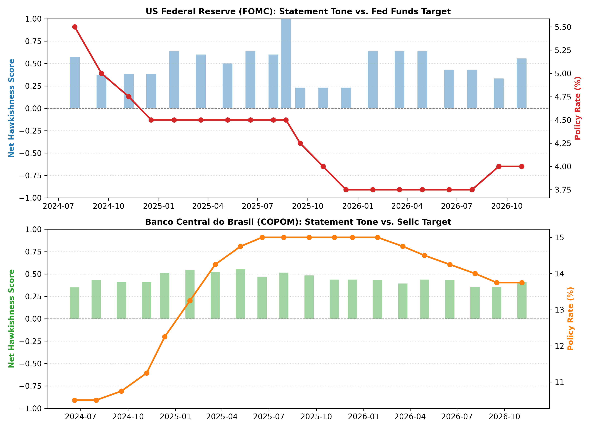

# Bilingual Central Bank Sentiment Analysis (FOMC vs. COPOM)

Central banks rarely surprise markets out of nowhere—they usually signal rate hikes or cuts in their policy statements well before making a move. In this project, I built a Python pipeline that collects policy statements from both the **US Federal Reserve (FOMC)** and **Banco Central do Brasil (COPOM)**, scores how hawkish or dovish their language is, and compares those text scores against actual interest rate decisions from FRED and the BCB API.

---

## Why I Kept It Bilingual

When people analyze foreign central banks in Python, the default shortcut is usually to run the text through a translator and score everything in English. For monetary policy, that tends to wash out the exact phrasing markets pay attention to. Words like *"cautela"* (caution), *"desancoragem"* (de-anchoring), or *"impactos altistas"* (upward pressures) carry specific weight in Brazilian monetary policy, just like *"elevated"*, *"restrictive"*, or *"solid pace"* do in Fed statements.

Instead of translating, I built two parallel lexicons—one in English and one in Portuguese—so each central bank is scored in its original language. Because COPOM communiqués are roughly three times longer than FOMC statements, I normalized the counts onto a `-1` to `+1` scale (`-1` = purely dovish, `+1` = purely hawkish) so the two series can be compared side by side.

---

## Where This Is Useful in Practice

For companies operating between the US and Brazil, the interest rate spread between the Fed Funds rate and the Selic drives borrowing costs, capital flows, and USD/BRL volatility. A tool like this is useful for:

* **Corporate Treasury & FX Teams:** Tracking when the Fed and BCB are diverging—for example, when one is still tightening while the other starts cutting—helps inform currency hedging and cross-border cash management.
* **Macro & Fixed-Income Research:** Turning unstructured policy releases into a clean numerical series makes it easier to spot subtle shifts in forward guidance before rate changes show up in the data.
* **Saving Analyst Time:** Instead of manually reading and comparing PDFs and press releases after every meeting, the script pulls new statements and updates the dataset automatically.

---

## Results (2024–2026)

Across the last 20 meetings for each central bank (40 meetings total):

| Central Bank | Language | Meetings | Avg. Net Hawkishness | Correlation with Rate Change ($r$) |
| :--- | :--- | :---: | :---: | :---: |
| **COPOM (Brazil)** | Portuguese | 20 | `0.445` | **`0.702`** |
| **FOMC (United States)** | English | 20 | `0.502` | **`0.483`** |

**What stood out in the numbers:**
* **COPOM's tone tracked rate moves closely ($r = 0.702$):** Sentiment scores climbed above `0.51` during Brazil's hiking cycle up to `15.00%`, cooled to `0.353` ahead of the `-25` bps rate cuts in mid-2026, and ticked back up to `0.412` in November 2026 when COPOM paused at `13.75%`.
* **FOMC scores captured the easing cycle, with one notable quirk ($r = 0.483$):** Fed hawkishness dropped to `0.231` during the late-2025 cuts from `4.50%` to `3.75%`. The correlation is lower than COPOM's largely because of a `1.000` spike on `2025-08-22`—a short inter-meeting release that matched just one hawkish keyword and zero dovish ones, with no rate change.

---

## What I Learned Building This

Working on this as an Economics and Data Science student highlighted a few things that don't always come up in classroom datasets:

1. **Off-the-shelf sentiment tools get central banks backwards:** Standard NLP sentiment libraries treat words like *"tightening"*, *"restrictive"*, and *"inflation"* as negative. In monetary policy, those are **hawkish** signals that usually point toward higher rates, so building a domain-specific lexicon made a noticeable difference.
2. **Government data comes in very different formats:** The Federal Reserve publishes static HTML pages where you have to strip out navigation links, release timestamps, and voting records before touching the text. Banco Central do Brasil serves its releases dynamically through an internal REST API (`sitebcb/copom/comunicados`), so I had to inspect the JSON structure and pull the HTML from `textoComunicado`.
3. **Ratios are sensitive to short documents:** Dividing $(\text{Hawkish} - \text{Dovish}) / (\text{Hawkish} + \text{Dovish})$ works well for standard 500-to-1,500-word statements, but a single keyword match in a brief announcement creates an artificial `1.0` spike. In a future version, adding a minimum word-count filter or smoothing factor would clean up those outliers.
4. **Aligning irregular dates:** Central banks meet eight times a year on irregular schedules, while target rates update daily. Using `pandas.merge_asof()` let me match each meeting to the exact rate the day before and three days after without introducing look-ahead bias.

---

## How the Pipeline Works

1. **Text Collection:** Scrapes FOMC statements from `federalreserve.gov` using `BeautifulSoup` and queries BCB's API for COPOM communiqués.
2. **Sentiment Scoring:** Uses regex word-boundary matching (`\b...\b`) against the English and Portuguese lexicons to calculate:
   $$\text{Net Hawkishness} = \frac{\text{Hawkish Terms} - \text{Dovish Terms}}{\text{Hawkish Terms} + \text{Dovish Terms}}$$
3. **Rate Merge & Export:** Fetches daily target rates from FRED (`DFEDTARU`) and BCB (`SGS Series 432`), calculates the basis-point change ($\Delta \text{bps}$) for each meeting, and exports the data and chart.

### Files in This Folder
* `fomc_copom_sentiment.py` — Main script for scraping, API requests, sentiment scoring, rate alignment, and plotting.
* `fomc_copom_sentiment_data.csv` — Merged dataset of 40 FOMC and COPOM meetings (2024–2026) with sentiment scores and rate changes.
* `fomc_copom_sentiment_chart.png` — Two-panel chart comparing net hawkishness against target interest rates.